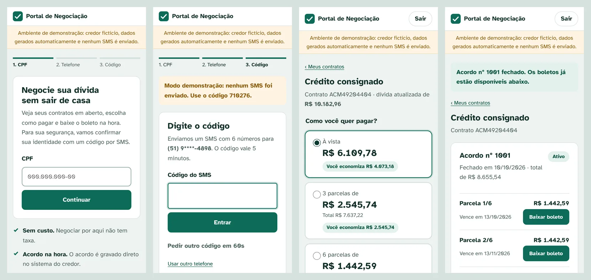
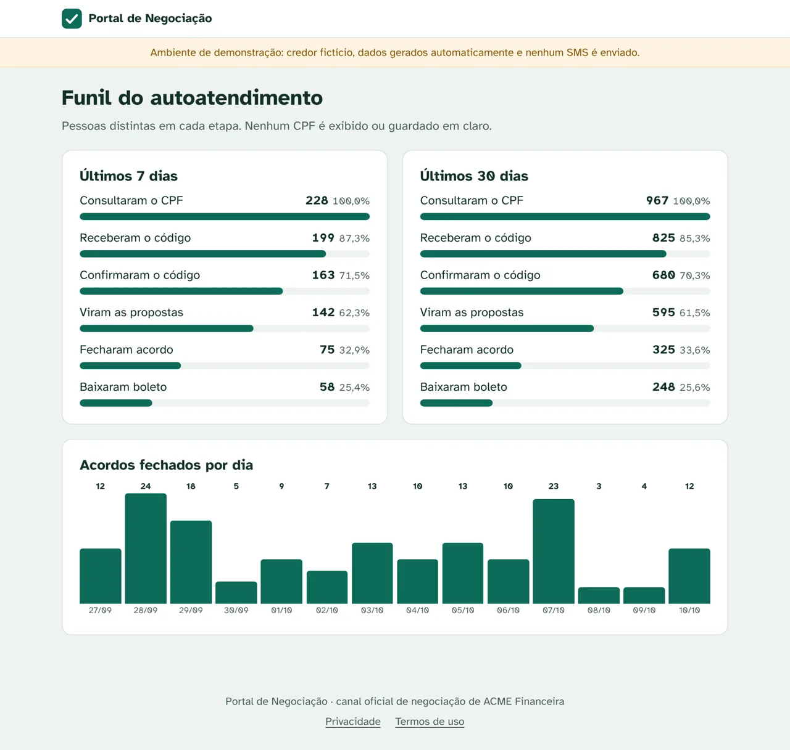

# Portal de autoatendimento para negociação de dívidas

[](https://github.com/wagnerglongo/autoatendimento-cobranca/actions/workflows/ci.yml)

Portal onde a própria pessoa negocia a dívida pelo celular: informa o CPF, confirma a identidade com um código por SMS, vê os contratos em aberto, escolhe à vista ou parcelado, fecha o acordo direto no sistema do credor e baixa os boletos.

Nasceu de um portal que desenvolvi para uma operação real de cobrança. Esta versão foi reescrita para ser publicada: o credor é fictício (**ACME Financeira**), atendido por um simulador da API dele, e nenhum dado, endereço ou credencial real está no repositório.



**Stack:** PHP 8.2+ sem framework · SQLite ou MySQL · cURL · PHPUnit · Docker Compose · GitHub Actions

## O que tem aqui

- **Identificação sem senha.** CPF validado pelos dígitos verificadores, escolha de um dos telefones que o credor tem (mostrados com máscara) e código de 6 dígitos por SMS: vale 5 minutos, aceita 5 tentativas, reenvio só depois de 60 segundos, e só o HMAC do código vai para o banco.
- **Negociação.** Propostas calculadas pelo credor (à vista com desconto e parcelados), escolha da data do primeiro vencimento, tela de revisão com o resumo e confirmação. O acordo é gravado na API do credor e os boletos aparecem na hora, em PDF.
- **Idempotência.** Cada tela de confirmação gera uma chave única. Duplo clique, botão voltar ou reenvio do formulário não criam dois acordos: o segundo envio nem chega ao credor.
- **Autorização por recurso.** O boleto só é entregue se a parcela pertence a um acordo da pessoa logada; trocar o número na URL devolve 404. O mesmo vale para contratos.
- **Integração resiliente.** Cliente HTTP com token OAuth2 em cache, renovação automática em `401`, novas tentativas com espera crescente em `429`/`5xx`/falha de rede (respeitando `Retry-After`) e uma página "temporariamente indisponível" em vez de erro quando o credor está fora. Detalhes em [docs/CREDOR_API.md](docs/CREDOR_API.md).
- **Links de campanha.** `bin/link.php` gera um link para SMS ou WhatsApp que leva a pessoa direto à escolha do telefone. O CPF vai cifrado (AES-256-GCM) e com validade; o código por SMS continua obrigatório.
- **Painel da operação** (`/painel`, protegido por senha). Funil de 7 e 30 dias (consultaram o CPF, receberam o código, entraram, viram propostas, fecharam acordo, baixaram boleto) e acordos fechados por dia.
- **LGPD.** O CPF nunca é gravado em claro: limites de tentativa, eventos e chaves de idempotência usam o HMAC dele. Os dados da dívida e do acordo ficam só no credor.



## Segurança

| Ameaça | Proteção |
|---|---|
| Enumeração de CPFs e abuso de SMS | Limite por IP (20 consultas / 15 min) e por CPF (10 / hora), guardado no banco para valer entre processos |
| Força bruta no código | 5 tentativas por código, validade de 5 min, intervalo de 60 s entre envios, comparação em tempo constante |
| CSRF | Token por sessão em todos os POST |
| Sequestro de sessão | Cookie `HttpOnly` e `SameSite=Lax` (`Secure` em HTTPS), `session_regenerate_id` ao entrar, expiração após 15 min sem uso |
| XSS | Escape em todo dado dinâmico e CSP sem scripts nem estilos inline (`script-src 'self'; style-src 'self'`) |
| Clickjacking e vazamentos | `frame-ancestors 'none'`, `X-Frame-Options`, `Referrer-Policy`, `Cache-Control: no-store` nas páginas |
| Acesso a dados de outra pessoa | Contrato e parcela conferidos contra o CPF da sessão antes de qualquer resposta |

## Como rodar

### Docker

```bash
cp .env.example .env
# preencha APP_SEGREDO com: openssl rand -hex 32
docker compose up -d --build
```

Abra http://localhost:8080 e use o CPF **111.444.777-35** (ou qualquer CPF válido: o simulador gera os contratos a partir do número). No modo demonstração nenhum SMS é enviado e o código aparece na tela.

Para ver o painel, gere a senha com `docker compose exec portal php bin/senha-painel.php`, coloque o resultado em `PAINEL_SENHA_HASH` no `.env` e suba de novo. `docker compose exec portal php bin/eventos-demo.php` cria 30 dias de eventos fictícios para o funil não começar vazio.

### Sem Docker

```bash
composer install
composer simulador                      # API do credor em http://localhost:8090
MODO_DEMO=1 composer serve              # portal em http://localhost:8000
```

### Testes

```bash
vendor/bin/phpunit
```

São 38 testes. Os de [`tests/FluxoTest.php`](tests/FluxoTest.php) percorrem o portal inteiro como a pessoa usaria (CPF, telefone, código, propostas, acordo, boleto) com SQLite em memória, relógio controlado e o simulador do credor rodando no mesmo processo. Também cobrem os caminhos ruins: código errado, sessão expirada, CSRF ausente, acordo enviado duas vezes, boleto de outra pessoa, credor fora do ar. O CI roda a suíte em PHP 8.2, 8.3 e 8.4 e sobe o `docker compose` para testar o portal falando com o simulador.

## Estrutura

```text
public/index.php            entrada: sessão, cabeçalhos de segurança, monta o App
src/App.php                 rotas e controladores do fluxo
src/Credor/ApiCredor.php    cliente da API do credor (único lugar que conhece o formato dela)
src/Seguranca/              CPF, CSRF, código por SMS, limite de tentativas, link de campanha
src/Sms/                    envio por webhook ou para arquivo (demonstração)
src/Eventos.php             funil do painel, sem dado pessoal
templates/                  páginas em PHP puro
simulador/                  API do credor ACME (fictício), a mesma do Pactua CRM
tests/                      PHPUnit
```

## Configuração

| Variável | Para quê |
|---|---|
| `APP_SEGREDO` | Chave dos HMACs e da cifra dos links (32+ caracteres). Obrigatória. |
| `MODO_DEMO` | `1` mostra o código na tela e a faixa de demonstração |
| `CREDOR_URL`, `CREDOR_USUARIO`, `CREDOR_SENHA` | API do credor |
| `SMS_DRIVER` | `log` (grava em `storage/sms.log`) ou `webhook` (`POST {"to","message"}` para `SMS_WEBHOOK_URL`) |
| `DB_DSN` | SQLite por padrão; aceita MySQL (`mysql:host=...;dbname=...`) |
| `PAINEL_SENHA_HASH` | Liga o `/painel` (gere com `php bin/senha-painel.php`) |

## Projetos relacionados

- [Pactua, CRM de cobrança](https://github.com/wagnerglongo/crm-cobranca): o lado do call center, que usa a mesma API do credor.

## Licença

MIT. A fonte Atkinson Hyperlegible é do Braille Institute, sob a SIL Open Font License.
